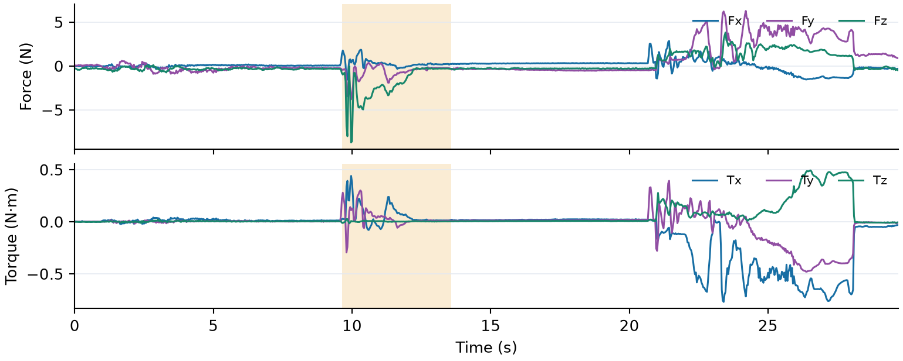

# CRIA 서랍 열기 이상 탐지

공개 데이터셋으로 로봇팔의 서랍 열기 동작을 분석한다. 힘·토크에서 이상 구간을 찾아 같은 시각의 영상과 대조한다. 그다음 손 끼임을 가상 위험 상황으로 두고, 실제 평가에 필요한 현장 증빙을 정리한다.

**149번 작업은 서랍 열기에 성공했다.** 사람이 이상으로 표시한 구간은 9.63–13.57초다. Random Forest는 9.80초에 첫 경보를 냈고, 주석 밖인 23.30초에도 경보를 냈다. 현장 위험등급은 작업자 노출과 방호조치 증빙이 필요해 판정 보류다.



[발표 자료(PPTX)와 보고서(DOCX) · v1.0.0](https://github.com/lifeschedule-dotcom/cria-drawer-anomaly-detection/releases/tag/v1.0.0) · [149번 가상 현장 사전 검토 예시](results/episode_000149_precheck_reachable.md)

## 실습 재현

Python 3.13 환경에서 저장소 루트에서 실행한다. 데이터 스크립트는 [고정 리비전의 CRIA 서랍 열기 기록](https://huggingface.co/datasets/Joringell/CRIA/tree/af288f2a470189c3991db73873f9d64171620a43/articulated/pull_drawer)에서 센서 표 150개, 메타데이터와 손목 영상 3편(8·17·149번)을 받아 `data/`에 저장한다. 원본 파일은 이 저장소에 포함하지 않았다.

```bash
python -m pip install -r requirements.txt
python download_data.py
```

[V3 실습 노트북](01_CRIA_Drill_v3.ipynb)을 VS Code의 Python·Jupyter 확장으로 열고, 위에서 패키지를 설치한 Python 환경을 커널로 선택한다. [풀이 노트북](01_CRIA_Solutions_v3.ipynb)과 [저장된 모델과 결과](results/)를 참고할 수 있다. 1~8단계는 영상과 주석 읽기, 센서 입력 만들기, 분할, 기준 모델, LSTM, 성능 비교, 현장 사전 검토, 초안 저장 순서다. 149번은 대표 사례이고 8·17번은 6단계 경보 비교에 쓴다.

저장된 결과로 실습하는 데 GPU는 필요 없다. 전체 학습은 `python train.py`로 다시 실행할 수 있다. 이 명령은 `results/`의 저장 모델과 점수를 갱신한다. 시드는 고정했으며, 실행 환경에 따라 학습 결과가 달라질 수 있다.

## 모델 비교

150개 에피소드를 학습 90 / 검증 30 / 테스트 30으로 나눴다. 로지스틱 회귀와 Random Forest에는 약 1초의 힘·토크 값을 요약한 특성 24개를, LSTM에는 120시점 × 6축 배열을 넣었다. 경보 임계값은 검증 F1으로 정했다. 아래 결과는 테스트 평가 구간 3,561개에서 계산했으며, 이 중 약 13.2%가 이상으로 표시됐다.

| 모델 | 정밀도 | 재현율 | F1 | AP |
| --- | ---: | ---: | ---: | ---: |
| 로지스틱 회귀 | 0.513 | 0.509 | 0.511 | **0.537** |
| Random Forest | **0.549** | **0.536** | **0.543** | 0.517 |
| LSTM | 0.539 | 0.532 | 0.535 | 0.509 |

Random Forest가 F1에서, 로지스틱 회귀가 AP에서 가장 높았다. Random Forest는 주석상 이상 구간의 약 54%를 탐지했다. 웹 데모는 경보를 검토할 영상 구간에 바로 접근하는 데 쓴다. [전체 지표](results/model_comparison.csv) · [149번 경보 그래프](docs/episode-149-alerts.png)

## 로컬 웹 데모와 검토 기록

웹 데모만 보려면 `python download_data.py --demo-only`로 세 에피소드만 받아도 된다. FFmpeg를 PATH에 추가한 뒤 아래 명령을 실행하고 브라우저에서 `http://localhost:8000`을 연다. 상단의 **실시간 탐지 → CRIA 기록 재생**을 선택하면 녹화된 작업을 분석할 수 있다.

```bash
python scripts/prepare_web.py
python -m http.server 8000 --directory web
```

- **현장 사전 검토**는 저장된 점수를 영상과 함께 재생하고, 가정한 작업 조건에 따라 증빙 목록을 보여준다.
- **실시간 탐지**는 녹화된 CRIA 영상 재생 중 그때까지 받은 CRIA 힘·토크 값을 써서, 브라우저의 Random Forest로 점수를 새로 계산한다. 카메라 연결은 영상 미리보기를 제공한다. 실제 힘·토크 센서 입력은 후속 작업이다.

위험성평가 검토 초안만 다시 만들려면 원본 데이터를 받은 뒤 `python safety_report.py --precheck reachable`을 실행한다.

## 출처

센서값, 영상 및 주석의 원본은 Yi Qiao, Maolin Zheng, Haoran Sun, Lujia Dong, Wenzhao Lian의 [Joringell/CRIA](https://huggingface.co/datasets/Joringell/CRIA)이며 [CC BY 4.0](https://creativecommons.org/licenses/by/4.0/)으로 배포된다. `articulated/pull_drawer` 데이터로 그래프와 이상 점수를 만들었다. 발표 자료의 149번 영상에는 자막과 사람이 표시한 이상 구간을 덧입혔다. 위험성평가 항목과 발표 자료의 기준표는 [세이프틱스 SafetyDesigner 공개 가이드](https://doc.safetics.io/docs/ra-est-eval/)를 참고했다. [세부 출처](THIRD_PARTY_NOTICES.md)
